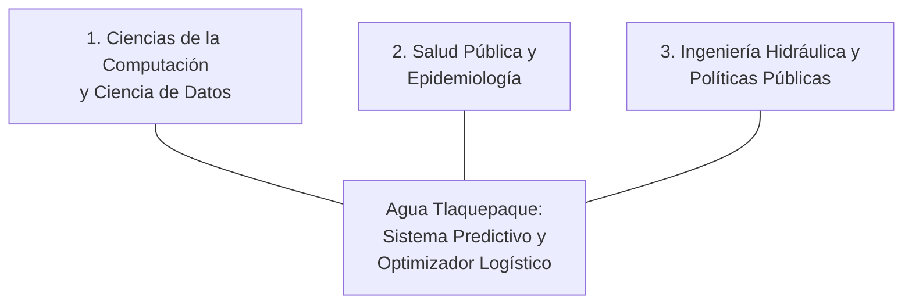

# Anexo C: Convergencia de Tres Áreas del Conocimiento
*(Cumplimiento estricto de la Indicación 4 y el Criterio 4 de Éxito del Reto 01)*

El proyecto no constituye un desarrollo tecnológico aislado, sino una solución interdisciplinaria donde convergen de manera orgánica tres campos del saber científico y técnico:

---

### 1. Ciencias de la Computación y Ciencia de Datos
* **Aporte a la solución:**
  - **Algoritmos de Optimización Combinatoria:** Implementación de un algoritmo voraz (*greedy algorithm*) geográfico que resuelve el problema de asignación espacial de la flota de 32 camiones cisterna bajo restricciones de capacidad física (10,000 L/viaje), ventanas de servicio y radios de caminata (300 m).
  - **Simulación Estadística y Análisis de Sensibilidad:** Ejecución de 36 escenarios deterministas y 600 simulaciones estocásticas de Monte Carlo con semilla controlada para identificar el *Núcleo Robusto de 186 manzanas críticas*, superando la incertidumbre de parámetros no observados en el censo.
  - **Ingeniería de Datos Espaciales:** Procesamiento de microdatos a escala de manzana urbana (4,871 unidades), geocodificación de centroides, análisis de intersección topológica y visualización geoespacial jerárquica mediante indexación hexagonal Uber H3 en arquitectura web moderna (Next.js / TypeScript).

### 2. Salud Pública y Epidemiología
* **Aporte a la solución:**
  - **Dinámica del Cloro Residual y Deterioro Biológico:** Integración del umbral sanitario oficial de la **NOM-127-SSA1-2021** (cloro residual libre entre 0.2 y 1.5 mg/L). Modelado del tiempo de almacenamiento crítico ($U = 48\text{ horas}$), sustentado en el estudio empírico de calidad del agua en Guadalajara (Rubino et al., 2019; PMC6339170), donde el 65% de los hogares analizados incumplió la norma de cloro y el 50% de los tinacos presentó coliformes.
  - **Prevención de Riesgos de Infecciones Gastrointestinales:** Clasificación de los estados sanitarios en función del tiempo de estancamiento del agua en depósitos domésticos y del fenómeno de intrusión de contaminantes en tuberías despresurizadas (*slug flow*), conforme a las directrices de la Organización Mundial de la Salud (OMS, 2022).
  - **Protocolos de Cloración Domiciliaria:** Generación de alertas sanitarias preventivas personalizadas para la ciudadanía a través del módulo *Mi Casa*, indicando el momento en que el agua almacenada requiere desinfección química con hipoclorito de sodio antes del consumo.

### 3. Ingeniería Hidráulica y Políticas Públicas
* **Aporte a la solución:**
  - **Mecánica de Redes de Suministro Intermitente:** Comprensión del régimen transitorio de la red de agua potable de la ZMG y el comportamiento de la Planta Miravalle. Modelación del retraso en la recuperación de la presión hidráulica hidrostática (*horas efectivas de corte* de 24 a 48 h) tras la apertura de válvulas del SIAPA.
  - **Balance Hídrico y Autonomía por Estratos:** Cálculo de la tasa de agotamiento de volumen en función del dimensionamiento de depósitos domiciliarios (750 a 1,100 L en tinacos; 2,500 a 5,000 L en cisternas) y del consumo en condiciones de contingencia (50 a 100 L/hab/día).
  - **Economía Urbana y Gestión de Emergencias Municipales:** Evaluación de la viabilidad presupuestal de la Dirección de Agua Potable y Protección Civil de San Pedro Tlaquepaque, articulando un modelo operativo de costo marginal cero para pipas y una propuesta de inversión de capital (*CapEx*) en cisternas fijas amortizables en el corto plazo.

