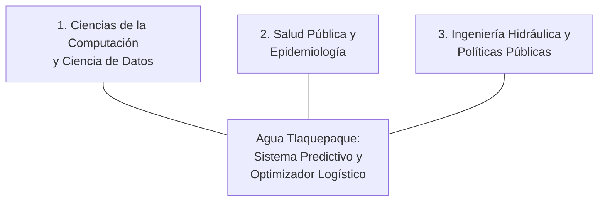

# Anexo C: Convergencia de Tres Áreas del Conocimiento
*(Cumplimiento estricto de la Indicación 4 y el Criterio 4 de Éxito del Reto 01)*

El proyecto no constituye un desarrollo tecnológico aislado, sino una solución interdisciplinaria donde convergen de manera orgánica tres campos del saber científico y técnico:

---

### 1. Ciencias de la Computación y Ciencia de Datos
* **Aporte a la solución:**
  - **Algoritmos de Optimización Combinatoria:** Implementación de un algoritmo voraz (*greedy algorithm*) geográfico que resuelve el problema de asignación espacial de la flota municipal de pipas bajo restricciones de capacidad física (10,000 L/viaje), número de viajes disponibles por jornada (63 viajes al día) y radios caminables de cobertura (300 m).
  - **Simulación Estadística y Análisis de Sensibilidad:** Ejecución de 36 escenarios deterministas y 600 simulaciones estocásticas de Monte Carlo con semilla controlada para identificar el *Núcleo Robusto de 186 manzanas críticas*, superando la incertidumbre de parámetros no observados en el Censo.
  - **Ingeniería de Datos Espaciales:** Procesamiento de microdatos a escala de manzana urbana (4,871 unidades), geocodificación de centroides, análisis de intersección topológica y visualización geoespacial jerárquica mediante indexación hexagonal Uber H3 en arquitectura web moderna (Next.js / TypeScript).

### 2. Salud Pública y Epidemiología
* **Aporte a la solución:**
  - **Tiempo de Almacenamiento como Indicador de Riesgo Sanitario:** El modelo no simula cloro ni calidad del agua. Usa un parámetro, el tiempo máximo de almacenamiento ($U = 48\text{ horas}$, con sensibilidad de 24 a 72 h), a partir del cual el agua guardada se marca como de riesgo. La NOM-127-SSA1-2021 (cloro residual libre entre 0.2 y 1.5 mg/L) es el marco de referencia de esa marca, no una variable calculada. El valor de $U$ está sustentado en las mediciones de retención en depósitos domésticos de Matsinhe et al. (2014, mediana de retención cercana a 2 días) y contrastado con la evidencia local de Guadalajara reportada por Rubino et al. (2019; PMC6339170), donde el 65% de los hogares analizados incumplió la norma de cloro libre y la mitad de los tinacos de azotea muestreados excedió el límite de coliformes totales (piloto de 51 casas, no representativo).
  - **Mecanismos de Contaminación en Redes Intermitentes:** Consideración de los riesgos microbiológicos asociados a la despresurización de tuberías y el arrastre de sedimentos contaminados (*slug*) documentados por Taylor et al. (2018) y las directrices de la Organización Mundial de la Salud (OMS, 2017).
  - **Desinfección Domiciliaria:** El módulo *Mi Casa* avisa cuando el agua lleva guardada más de $U$ horas y recomienda desinfectarla con cloro doméstico (2 gotas por litro y 30 minutos de reposo), según la guía de emergencia de los CDC de Estados Unidos (renglón S001 de `datos/evidencia.csv`). Contrastarla con una guía de la Secretaría de Salud sigue pendiente.

### 3. Ingeniería Hidráulica y Políticas Públicas
* **Aporte a la solución:**
  - **Mecánica de Redes de Suministro Intermitente:** Análisis del esquema de rotación y tandeo del SIAPA en las colonias que abastece la Planta Potabilizadora No. 1 de Miravalle (renglón P018 de `datos/evidencia.csv`). Modelación de la duración de corte declarada como supuesto operativo (*horas efectivas de corte* de 24 a 48 h) y de la fracción de suministro residual en baja presión ($f = 0$ a $0.5$).
  - **Balance Hídrico y Autonomía por Estratos:** Cálculo de la tasa de agotamiento de volumen en función del dimensionamiento físico de depósitos domiciliarios (750 a 1,100 L en tinacos; 2,500 a 5,000 L en cisternas) y del consumo per cápita bajo racionamiento (50 a 100 L/hab/día).
  - **Economía Urbana y Gestión de Servicios Públicos:** Evaluación de la viabilidad presupuestal del operativo municipal (`optimizador/docs/viabilidad-presupuestal.md`), con los mismos viajes que el municipio ya realiza y sin aumentar el gasto. En el escenario base, la regla de asignación atiende entre 1.4× y 5.6× las viviendas-día del baseline, según la cota y el baseline (`optimizador/resultados/resumen.md`); en las esquinas adversas de la sensibilidad (consumo de 100 a 150 L y tinacos menores) la ventaja baja a 1.2× con la cota mínima y a 1.1× con la máxima.
